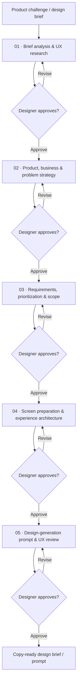

# Rapid UX Launchpad

**Think before you design. Use AI to accelerate the work—not replace design judgment.**

Rapid UX Launchpad is a structured, five-skill workflow for UX and product designers. It helps turn an ambiguous product challenge into an approved, design-ready direction through research framing, product strategy, requirements, screen architecture, and design-prompt refinement.

It is built around one principle: **AI proposes; the designer reviews and decides.** Each stage has an explicit human-approval checkpoint before work moves forward.

<p align="center">
  <a href="https://github.com/mayurux/Rapid-UX-Launchpad/stargazers"></a>
  <a href="https://github.com/mayurux/Rapid-UX-Launchpad/network/members"></a>
  <a href="https://github.com/mayurux/Rapid-UX-Launchpad/issues"></a>
</p>

## Why use it?

A common failure mode in AI-assisted design is jumping from a short brief straight to screens. That can produce polished-looking UI while important questions remain unanswered:

- Are we solving the right user problem?
- Does the proposed direction support the business objective?
- What belongs in the MVP—and what should wait?
- What information, actions, interactions, and states does each screen need?
- Can a design-generation tool follow the brief without inventing product behaviour?

Rapid UX Launchpad inserts structured thinking and review checkpoints before design generation. It does not claim to replace user research, product judgment, or designer validation.

## The five-skill workflow



| Skill | Focus | Main output |
|---|---|---|
| [**01 — Brief Analysis & UX Research**](01_Brief_Analysis_and_UX_Research.md) | Users, goals, current workflow, pain points, evidence and assumptions | Approved research foundation |
| [**02 — Product, Business & Problem Strategy**](02_Product_Business_and_Problem_Strategy.md) | Business objectives, user–business alignment, root causes and opportunities | Approved problem definition and product direction |
| [**03 — Requirements, Prioritization & Scope**](03_Requirements_Prioritization_and_Scope.md) | Functional requirements, MVP, MoSCoW priorities, constraints and edge cases | Approved requirements and design-ready brief |
| [**04 — Screen Preparation & Experience Architecture**](04_Screen_Design_Preparation_and_Experience_Architecture.md) | Screen purpose, information architecture, content, interactions, states and design direction | Approved screen specification and initial design prompt |
| [**05 — Design Prompt Specialist & UX Reviewer**](05_Design_Generation_Prompt_Specialist_and_UX_Design_Reviewer.md) | Prompt audit, design-system fidelity, interaction coverage and prompt refinement | Approved, self-contained design-generation prompt |

**Modular by design:** each skill is a separate Markdown file. The recommended end-to-end workflow is sequential because later skills depend on approved decisions from earlier stages.

## Who is it for?

- UX and product designers working on product-design exercises or real product challenges.
- Senior designers who need a repeatable way to structure ambiguous briefs.
- Design leads building more consistent AI-assisted design practices.
- Designers working on B2B, enterprise SaaS, workflow-heavy, or data-intensive products.

## What makes it different?

- **Human approval gates:** the workflow pauses for review at every stage.
- **Evidence discipline:** facts, evidence, hypotheses, assumptions, and unknowns must remain distinct.
- **Traceable decisions:** each stage produces a named handover for the next stage.
- **Scope control:** the workflow challenges unnecessary complexity and protects MVP boundaries.
- **Design readiness:** it specifies content, actions, behaviour, states, constraints, and design-system considerations before screen generation.
- **No pretend research:** it must not fabricate interviews, customer feedback, usage metrics, product capabilities, or technical constraints.

## Get started

### 1. Download the skill files

Clone the repository:

```bash
git clone https://github.com/mayurux/Rapid-UX-Launchpad.git
cd Rapid-UX-Launchpad
```

Or download the repository as a ZIP from GitHub.

### 2. Add the files to your AI workspace

Use an AI assistant that supports project-level instructions and uploaded reference files.

For ChatGPT:
1. Create a Project named **Rapid UX Launchpad**.
2. Upload the five skill Markdown files as Project sources.
3. Add the project instruction below.
4. Start a separate chat for each skill, in sequence.

For other assistants, use the equivalent project/knowledge-base feature if available. Feature names and file limits vary by platform; check the platform's current documentation.

### 3. Add these project instructions

```text
You are using Rapid UX Launchpad, a five-skill UX workflow.

Use the uploaded Markdown files as the source of truth. When I say
"Run Skill 01" through "Run Skill 05", follow only the requested skill.

Keep responses concise, structured, and evidence-aware. Distinguish
confirmed facts, evidence, hypotheses, assumptions, and unknowns.
Never invent research, user feedback, metrics, product behaviour,
business rules, or technical constraints.

Follow the skill's review questionnaire and wait for my explicit
approval before finalizing its output or moving to the next skill.
Preserve approved decisions and include the exact named handover
required by each skill.

Skills 04 and 05 prepare screen specifications and design-generation
prompts. Do not generate UI, wireframes, prototypes, or code unless
I explicitly request a separate task to do so.

Challenge weak assumptions respectfully. Do not silently change
previously approved decisions.
```

### 4. Run the skills in order

Start a separate conversation for each stage. Paste the relevant command and the brief/handover.

| Start with | Command |
|---|---|
| Skill 01 | `Run Skill 01 — analyze this design challenge: [paste brief]` |
| Skill 02 | `Run Skill 02 — use the approved Brief & UX Research handover.` |
| Skill 03 | `Run Skill 03 — use the approved Skill 01 and Skill 02 handovers.` |
| Skill 04 | `Run Skill 04 — use the approved Requirements & Design-Ready Brief handover.` |
| Skill 05 | `Run Skill 05 — use the approved Design Direction & Prompt handover.` |

**Important:** do not skip approval gates. If a required handover is missing, stop and complete the predecessor skill first.

## Repository structure

```text
Rapid-UX-Launchpad/
├── README.md
├── 01_Brief_Analysis_and_UX_Research.md
├── 02_Product_Business_and_Problem_Strategy.md
├── 03_Requirements_Prioritization_and_Scope.md
├── 04_Screen_Design_Preparation_and_Experience_Architecture.md
├── 05_Design_Generation_Prompt_Specialist_and_UX_Design_Reviewer.md
├── CONTRIBUTING.md
├── CHANGELOG.md
└── .github/
    ├── ISSUE_TEMPLATE/
    │   ├── bug_report.md
    │   └── feature_request.md
    └── PULL_REQUEST_TEMPLATE.md
```

## Responsible use

Rapid UX Launchpad is a decision-support framework, not a substitute for:
- Direct user research and usability testing.
- Product, legal, security, accessibility, or engineering review.
- Validated product analytics and business evidence.
- Designer ownership of the final experience.

Treat AI-generated outputs as drafts until reviewed and validated. Do not upload confidential customer, employee, or company information to an AI service unless your organization's policies permit it.

## Contributing

Ideas, corrections, examples, and improvements are welcome. Please read [CONTRIBUTING.md](CONTRIBUTING.md) before opening an issue or pull request.

If you find the workflow useful, consider giving the repository a ⭐ on GitHub. It helps other designers discover it.

## Roadmap

Potential directions for future community-driven development:

- [ ] Add anonymized end-to-end examples showing inputs, review decisions, and outputs.
- [ ] Add a quick-start walkthrough with a realistic sample brief.
- [ ] Gather feedback from designers using different AI platforms.
- [ ] Improve guidance for design-system and accessibility reviews.
- [ ] Publish versioned releases as the workflow stabilizes.

Roadmap items are proposals, not promises or completed features.

## Feedback and support

- [Open an issue](https://github.com/mayurux/Rapid-UX-Launchpad/issues) for bugs, unclear instructions, or improvement ideas.
- Use GitHub Discussions if enabled for broader workflow questions.
- Review the five skill files to understand each stage's inputs, review gate, and handover.

---

**Built for designers who want AI to accelerate the process without outsourcing design judgment.**
